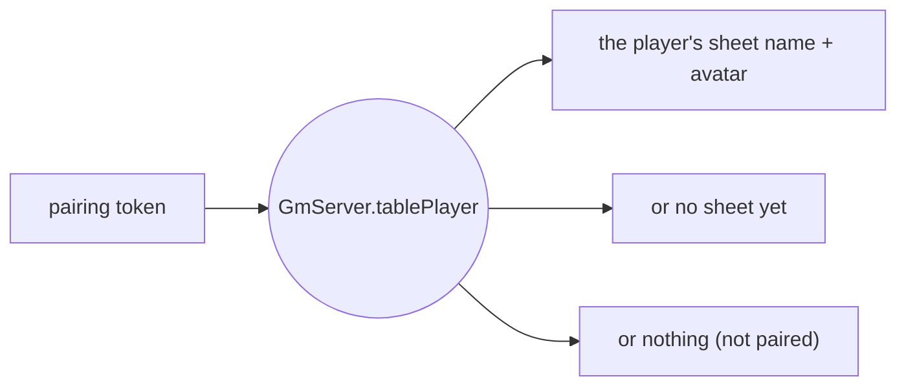
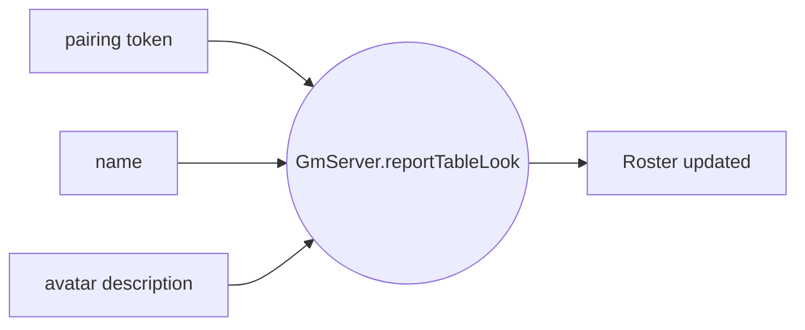
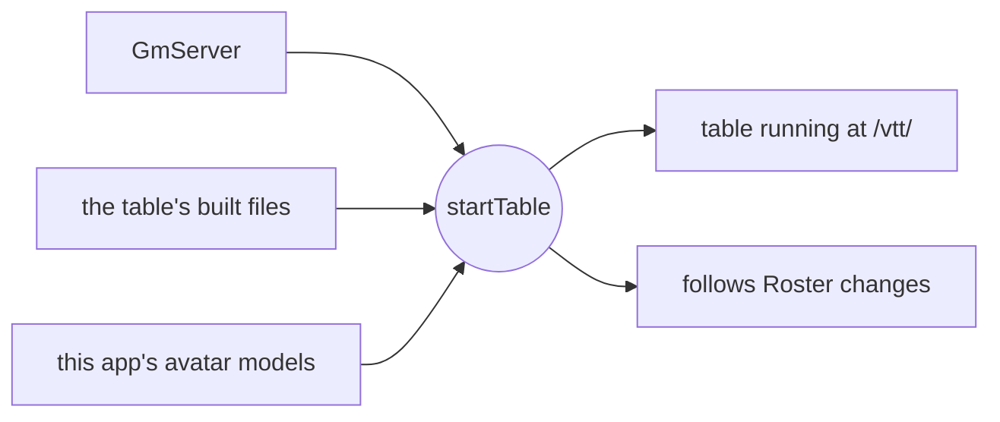
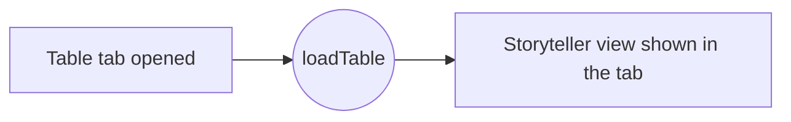
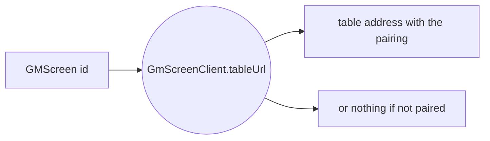
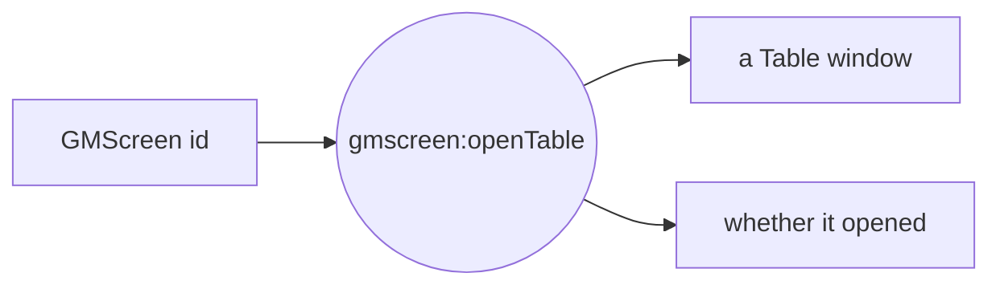

# GMScreen + VTT table

One plain-language diagram per function added for running the VTT table inside GMScreen (2026-11-13).

[Back to index](README.md)

## GmServer.tablePlayer

`gmscreen/src/gm-server.js` - The VTT table asks who's behind a pairing token: their sheet's name and avatar (look only), or nothing if it isn't a pairing.

## GmServer.reportTableLook

`gmscreen/src/gm-server.js` - A player who paired from the table's browser lobby (no Character Manager): puts the name and look they picked there on the Roster. Never overwrites a Character Manager's avatar.

## startTable

`gmscreen/src/main.js` - Starts the VTT table inside GMScreen on its own port: serves /vtt/, the live game channel, and links joining to this session's pairing and players' sheets.

## loadTable

`gmscreen/src/js/renderer.js` - The first time the Table tab is opened, loads the table's Storyteller view (with this run's secret) into it.

## GmScreenClient.tableUrl

`src/js/gmscreen-client.js` - The address of a paired GMScreen's table, with this device's pairing in the link (#fragment, never sent in a request).

## gmscreen:openTable

`src/main.js` - Character Manager's Join table: opens the GM's table in its own sandboxed window.

